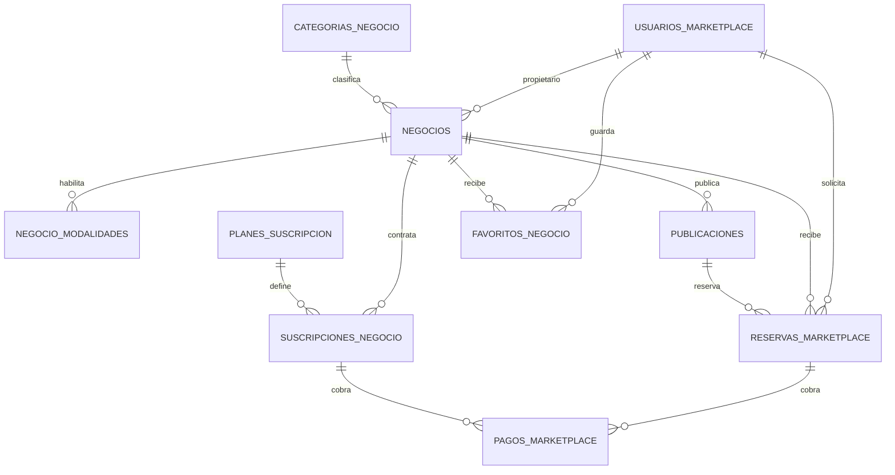

# Modelo definitivo del marketplace — SQLite v8

## 1. Actores y monetización

- **Cliente (`usuarios_marketplace`)**: cuenta gratuita. Puede explorar negocios, guardar favoritos y crear reservas. No paga mensualidad a la plataforma.
- **Propietario (`negocios.propietario_usuario_id`)**: usuario que administra uno o más negocios. No se necesita duplicar su identidad al cambiar de rol: una misma cuenta puede ser cliente y propietario.
- **Negocio (`negocios`)**: unidad comercial independiente, con categoría, datos de contacto, ubicación local y estado operativo.
- **Suscripción (`suscripciones_negocio`)**: se asocia al negocio, nunca al cliente. El alta es autoservicio y crea un período de prueba de 14 días. Las tarifas comerciales permanecen sin definir (`precio_mensual = NULL`) hasta aprobar el tarifario.
- **Personal (`negocio_modalidades`)**: en esta primera versión los permisos de equipo se reservan para una evolución posterior; la relación propietario-negocio deja el dominio preparado para ello.

## 2. Catálogo multi-rubro

`categorias_negocio` es un catálogo extensible, no un conjunto de pantallas fijas. El catálogo inicial incluye barbería/peluquería, belleza/uñas, salud/bienestar, comida/restaurantes, talleres/mantenimiento, tiendas/productos, educación/asesorías y otros.

`publicaciones` permite que un negocio anuncie servicios o productos. Cada publicación define modalidad `CITA`, `RECOJO` o `AMBOS`, precio, precio anterior (para ofertas), duración (cuando aplique) y stock (cuando aplique). La publicación no puede ofrecer una modalidad que el negocio no haya habilitado.

## 3. Operaciones y pagos

- `reservas_marketplace` guarda citas y pedidos de recogida en una sola entidad, distinguidos por `modalidad`.
- Las citas guardan inicio y fin para validar solapamientos por negocio.
- Los pedidos de recojo guardan fecha/hora prevista y cantidad.
- El estado operativo de la reserva es independiente del estado del pago.
- `pagos_marketplace` acepta canal `EN_LINEA` o `EN_LOCAL` y separa pagos de reservas y pagos de suscripción.
- Una reserva online inicia como `PENDIENTE`. No se declara pagada hasta que una pasarela real confirme el cobro.

## 4. Cobertura

El alcance inicial es `LOCAL`. Se guarda departamento, provincia y distrito para filtros geográficos. Latitud/longitud son opcionales y permiten incorporar distancia/radio más adelante. No se habilita una búsqueda nacional ni se inventa disponibilidad fuera de la zona atendida.

## 5. Relaciones principales

## 6. Migración y compatibilidad

- Base nueva: crea el módulo operativo anterior y el marketplace.
- Base v7: agrega tablas e índices marketplace sin borrar datos existentes.
- Las tablas `clientes`, `servicios` y `citas` y sus repositorios permanecen disponibles desde el acceso **Agenda clásica del negocio**.
- La agenda antigua todavía no está fusionada con `reservas_marketplace`: se conserva aislada para evitar mezclar registros sin identidad/negocio propietario. Su integración multi-tenant requiere escoger el negocio activo y migrar la agenda por tenant en una fase posterior.

## 7. Decisiones pendientes antes del lanzamiento público

1. Proveedor real de autenticación y API central para sincronizar varios teléfonos.
2. Tarifas finales, límites por plan y reglas de renovación/suspensión.
3. Pasarela de pago, conciliación, reembolsos y webhooks.
4. Verificación de identidad/propiedad, moderación y políticas de cancelación/no-show.
5. Motor de disponibilidad y horarios excepcionales, zona horaria y notificaciones.
6. Geolocalización, radio/zonas de reparto y expansión de cobertura.

SQLite local es una base de prototipo y operación sin conexión en un dispositivo. No permite que distintos teléfonos compartan reservas en tiempo real ni evita por sí sola dobles reservas entre dispositivos; esas garantías deben residir en el backend transaccional.
